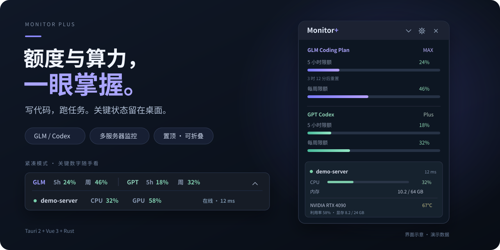

<div align="center">

# Monitor Plus

### 写代码，跑任务。额度与算力，一眼掌握。

把 **GLM / Codex 订阅额度**和**多台服务器的 CPU、GPU、显存状态**放进桌面悬浮窗。

[](https://github.com/anyang1991/monitor_plus/releases/latest)
[](https://github.com/anyang1991/monitor_plus/releases/latest)
[](https://tauri.app/)
[](https://vuejs.org/)
[](LICENSE)

**[下载 Windows 安装包](https://github.com/anyang1991/monitor_plus/releases/latest)** · [接入服务器](docs/AGENT_DEPLOY.md) · [源码构建](docs/WINDOWS_BUILD.md) · [反馈问题](https://github.com/anyang1991/monitor_plus/issues)



</div>

## 少切一次窗口，多专注一会儿

写代码时想知道订阅额度还剩多少，跑训练时又想盯住服务器负载。Monitor Plus 把这些信息放在工作窗口旁边：展开看详情，折叠看关键数字。

| 你关心什么 | Monitor Plus 帮你看到什么 |
| --- | --- |
| GLM / Codex 还能用多久？ | 5 小时与每周额度用量、重置倒计时，以及可用的套餐信息 |
| 训练任务有没有占满 GPU？ | 每块 NVIDIA GPU 的利用率、显存占用和温度 |
| 多台机器的负载怎么样？ | 按服务器展示 CPU、内存、在线状态和请求耗时 |
| 想持续关注，又想留住桌面空间？ | 置顶悬浮窗、两行紧凑模式、拖动定位和系统托盘 |

## 你会用到的功能

- **双平台额度看板**：同时查看 GLM Coding Plan 与 Codex 订阅用量，70% / 90% 用量变色提示。
- **本机凭据检测**：GLM 支持读取 ZCode 凭据或手动填写 API Key；Codex 支持检测本机登录凭据，跟随凭据文件更新。
- **多服务器监控**：每台机器一张卡片，集中查看 CPU、内存和多块 NVIDIA GPU；服务器轮询间隔可选 2–10 秒。
- **桌面随手看**：无边框、置顶、可拖动、位置记忆；关闭窗口可隐藏到托盘，支持设置开机自启。
- **Python 单文件 Agent**：使用 Python 标准库采集指标，提供 Windows 计划任务与 Linux systemd 部署方式，支持访问令牌。
- **自定义更新源**：通过版本清单检查更新，支持 GitHub 公开下载与 GitLab 私有通道。

另附 Codex 重置动态提示，数据来自第三方公共聚合源，供关注相关动态时参考。

## 开始使用

### 1. 下载并安装

前往 **[最新版本](https://github.com/anyang1991/monitor_plus/releases/latest)**，下载 `MonitorPlus_<版本>_x64-setup.exe` 并运行。

当前提供 **Windows x64 安装包**。macOS / Linux 用户可从源码构建。

如果你还在使用 **0.2.x**，请手动安装 0.3.0 或更高版本：旧版使用的私有更新令牌已停用，新版提供可配置的更新通道。

### 2. 接入你要看的数据

打开悬浮窗右上角的 **⚙ 设置**，按需要配置即可。

| 数据 | 怎么接入 |
| --- | --- |
| GLM Coding Plan | 已登录 ZCode 时可读取本机凭据；也可手动填入 API Key，并选择 `bigmodel.cn` 或 `api.z.ai` 端点。 |
| Codex 订阅 | 在这台电脑上登录 Codex CLI，再点击「自动检测 Codex 凭据」。API Key 登录模式没有订阅额度可查。 |
| 服务器 CPU / GPU | 在目标机器运行 Agent，填入 `http://服务器IP:9101` 和对应令牌，点击「测试」后保存。 |

### 3. 留在桌面，随时查看

拖动标题栏调整位置；点击折叠按钮进入紧凑模式，双击紧凑条展开。点击关闭按钮可隐藏到托盘，从托盘菜单重新显示或退出。

## 接入服务器：一个 Python 文件即可开始

在**被监控的机器**上运行下面的命令。先把 `YOUR_RANDOM_TOKEN` 替换为你生成的随机令牌；桌面端填写相同的值。

```bash
python3 agent/agent.py --bind 0.0.0.0 --port 9101 --token YOUR_RANDOM_TOKEN
```

Windows 使用 `python` 命令即可。GPU 指标需要已安装 NVIDIA 驱动，并能运行 `nvidia-smi`；没有 NVIDIA GPU 也可以查看 CPU 和内存。

在运行 Monitor Plus 的电脑上验证连通性：

```bash
curl -H "X-Agent-Token: YOUR_RANDOM_TOKEN" http://SERVER_IP:9101/metrics
```

这里的地址填 Agent 的**基础地址**，无需附加 `/metrics`。跨机器访问需要路由可达，并放行对应的防火墙 / 安全组端口。HTTP 令牌不提供传输加密；跨公网建议通过 VPN、SSH 隧道或 HTTPS 反向代理连接。

长期运行与自动启动方法见 **[Agent 部署指南](docs/AGENT_DEPLOY.md)**。

## 配置应用更新

**0.3.0 用户请先在「设置 → 应用更新 → 清单地址」填入以下地址，公开通道的访问令牌留空，保存后重新打开设置并检查更新：**

```text
https://github.com/anyang1991/monitor_plus/releases/latest/download/latest.json
```

自建 GitLab 通道时，填写自己的 `latest.json` 清单地址，以及该仓库的访问令牌。令牌保存在本机配置中；发布文件和源码里不需要放入令牌。

[更新与发布说明 →](docs/RELEASE.md)

## 从源码运行

准备 Node.js 22.12+、pnpm、Rust，以及对应平台的 Tauri 构建依赖。Windows 的完整环境步骤见 [构建指南](docs/WINDOWS_BUILD.md)。

```bash
git clone https://github.com/anyang1991/monitor_plus.git
cd monitor_plus
pnpm install
pnpm tauri dev
```

构建安装包：

```bash
pnpm tauri build
```

主要目录：

```text
src/              Vue 3 悬浮窗、额度面板与服务器卡片
src-tauri/src/    Rust 配额请求、Agent 轮询、配置与窗口管理
agent/            Python 指标采集脚本与部署文件
docs/             构建、服务器接入和发布说明
updates/          更新清单示例
```

## 常见问题

**Codex 额度一直获取失败？**

确认本机 Codex CLI 已登录 ChatGPT 账户，并能访问 `chatgpt.com`。当前版本会探测本机 `127.0.0.1:7890` HTTP 代理，未发现可用代理时尝试直连。令牌失效时先运行 Codex CLI 完成凭据更新，再重新检测。

**Agent 在本机正常，桌面端却显示离线？**

从运行 Monitor Plus 的电脑请求 Agent 的 `/metrics` 接口，依次检查目标地址、服务进程、防火墙 / 安全组和访问令牌。本机 `127.0.0.1` 验证成功只代表 Agent 已启动。

**凭据怎么处理？**

GLM / Codex 凭据在本机解析，并用于向相应服务发送鉴权请求。手动配置或缓存的令牌可能以明文保存在应用配置文件中，请保护该文件并避免上传到仓库。Agent 会按配置暴露主机名与硬件负载数据。

## 反馈与贡献

欢迎通过 [Issues](https://github.com/anyang1991/monitor_plus/issues) 提交问题或需求，也欢迎 PR。反馈时附上应用版本、操作系统和复现步骤；日志与截图请先移除令牌、账号信息和私有服务器地址。

如果这个小窗帮你省下了来回切换窗口的时间，欢迎点个 **Star**，也让更多写代码、跑任务的人发现它。

## License

[MIT](LICENSE)

<details>
<summary>English overview</summary>

Monitor Plus is a floating desktop widget for GLM Coding Plan and Codex subscription usage, alongside CPU, memory and NVIDIA GPU metrics from multiple servers. Keep quota windows, reset countdowns and server workloads in view while you code or run jobs.

Built with Tauri 2, Vue 3 and Rust. Remote metrics come from a single-file Python agent using the standard library. Windows x64 installers are available in [Releases](https://github.com/anyang1991/monitor_plus/releases/latest); macOS and Linux can be built from source.

</details>
